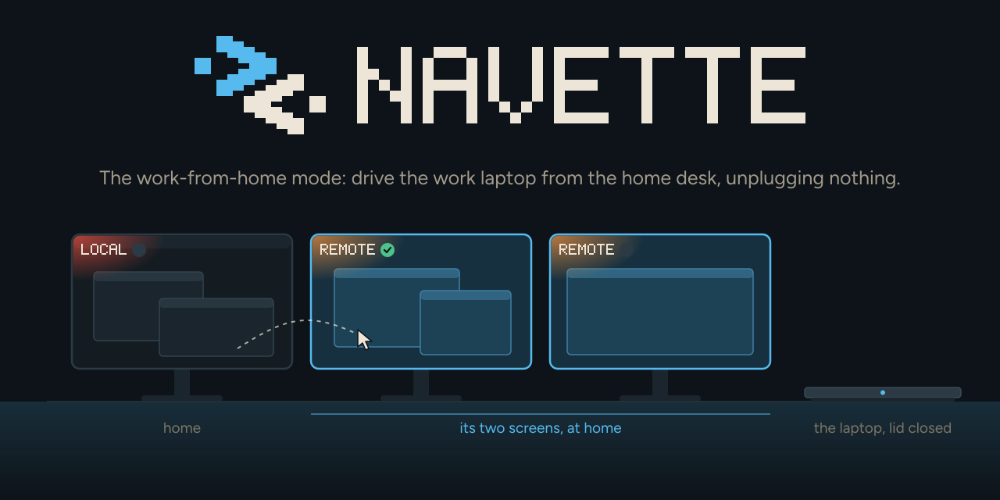
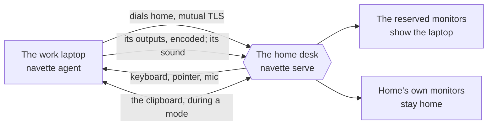
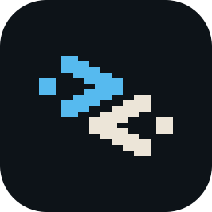

<div align="center">



[](https://github.com/KristenJestin/navette/releases)
[](LICENSE)
[](https://github.com/KristenJestin/navette/actions/workflows/ci.yml?query=branch%3Adev)

</div>

## What it is

The work-from-home mode for two Hyprland machines on the same home LAN, written in Rust.

From the home desk (several monitors, keyboard, mouse, mic, speakers), Navette drives a
separate, employer-managed work laptop without unplugging anything, the way a remote desktop
with several monitors did on Windows. A mode gives some of the home monitors to the laptop: they
show its desktop fullscreen, as if they were its own monitors, the pointer crosses from one
machine to the other at their edge, and the keyboard follows it. It is early development, built
for Omarchy 4, and three rules shape it:

- **The two machines stay apart.** Navette moves pixels, input, sound and the clipboard over the
  LAN, never one machine's accounts, passwords or tokens to the other. The certificate made at
  pairing opens the link between the two Navette and nothing else.
- **The laptop's security is never touched.** It never listens: it dials home, as a systemd user
  service, without root, with no port, no sshd and no firewall change. Its VPN, routing and DNS
  stay as its owner set them.
- **Home monitors are never moved or reconfigured.** A mode records what it changes on the home
  desk and gives it back when it stops, when the link drops, or at the next start after a crash.

## How it works



1. **Pair once.** `navette pair --listen <lan address:port>` at home shows a PIN; `navette pair
   <address:port>` on the laptop asks for it. From then on, each side pins the other's
   certificate.
2. **Start a mode.** `navette mode start office` gives the monitors named in `mode.conf` to the
   laptop. It makes one headless output for each, with the same resolution and orientation, in
   the same left-to-right order, and streams them; home covers each monitor with the picture.
3. **Work.** Over a reserved monitor, the keyboard and every shortcut (Super included) go to the
   laptop; over any other, to home. The laptop's sound plays on the home speakers, mixed with
   home's. The mic goes to one machine at a time, switched by a hotkey that works even while the
   laptop has the keyboard, or by the button of the corner every monitor shows.
4. **Stop it.** `navette mode stop`: the monitors, their workspaces and the mic come back home,
   and the laptop's outputs are removed.

## The pieces

One program, `navette`, with two roles:

- **At home**, `navette serve` waits for the paired laptop and keeps its link up; `navette mode`,
  `navette status` and `navette mic` drive it. Home decodes the pictures on its GPU (Vulkan
  Video, or the CPU without one), mixes the sound, routes the mic, and draws the corner of each
  monitor: which machine it shows, and where the mic is.
- **On the laptop**, `navette agent` makes the headless outputs, captures and encodes them
  (VA-API), injects the input, plays the mic, and keeps working with its lid closed while a mode
  runs.

Navette is built on the library crates of [gliff](https://github.com/omacom/gliff) (capture,
encode and decode, input, protocol, transport), taken from the fork
[navette-gliff](https://github.com/KristenJestin/navette-gliff) (branch `navette`: upstream plus
Navette's changes, kept in sync with upstream) and pinned by commit. What is specific to the
work-from-home mode (pairing, modes, monitor mapping, mic routing, rollback) is Navette's own.

## Documentation

- [The link](docs/link.md): pairing, the clipboard, the home firewall, the threat model.
- [The mode](docs/mode.md): the monitors, named modes, the corner, the laptop's workspaces and
  lid, keyboard and pointer, decoding.
- [The remote machine's sound](docs/audio.md) and [the home mic](docs/mic.md).
- [Events](docs/events.md): where each machine stands, for a bar or a shell (`navette watch`).
- [What a version promises](docs/versions.md).

## Install

A release or the beta of `dev`, without building: unpack the archive on each machine and run its
`install.sh`, which installs the binary, the icon its notifications show and the one systemd unit
for both machines, then `systemctl --user enable --now navette` once paired:
[`docs/install.md`](docs/install.md). Install the same version on both.

## Build

Building needs the PipeWire development files, clang and cmake (Arch: `pipewire clang cmake`;
Debian and Ubuntu: `libpipewire-0.3-dev libclang-dev cmake`).

```
cargo build
cargo test
```

## Contributing

[`AGENTS.md`](AGENTS.md) says how the repository works, for people and for coding agents.

## Licence and credits



Apache-2.0. Code reused from gliff (MIT) keeps its MIT notice ([`LICENSES`](LICENSES)).
The logo, the icon and the banner are in [`assets/brand`](assets/brand/README.md); the banner is
drawn with Figtree and JetBrains Mono, under the SIL Open Font License 1.1
([`assets/brand/fonts`](assets/brand/fonts/README.md)).
